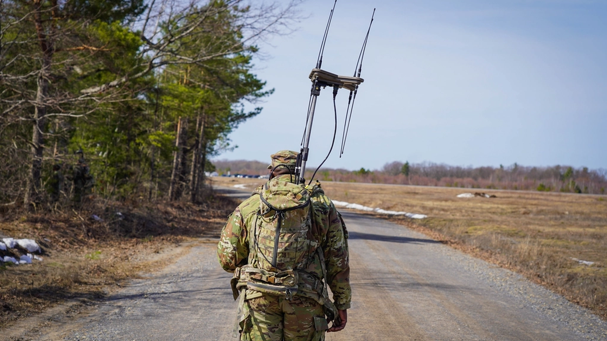

# The Week in Seed: Seed Money Went to Owning the Hard Part, Not Renting It

### A neutral test range for military autonomy, a drone-submarine maker with Navy deliveries scheduled, reinforcement learning on companies' own agent logs, document parsing built for agents, and an AI law firm that sells conveyancing directly to home buyers

This week's notable early-stage rounds had one thing in common: each startup chose to own something others would rather rent or outsource. That meant the test range rather than the weapon, the trained model rather than the API call, and the regulated firm rather than the software sold to it.

## Autonomous weapons need a referee before they get a budget

Defense money is moving fast toward autonomy, and the weak point is no longer whether drones and robotic vessels can be built. It is whether anyone can show they work before they are bought in quantity. Most testing of new military systems is still run by the vendors that build them or by government ranges with long queues. That arrangement was tolerable when a program bought a few expensive platforms over a decade. It breaks down when the Pentagon wants to buy thousands of cheap autonomous systems a year from dozens of new suppliers.

We have written about testing as a product before: in October about robot test tooling, and about software testing becoming the bottleneck once AI writes the code. This week the same logic reached weapons. The pitch is not a better drone. It is independent evidence of how drones and their operators behave under realistic conditions, recorded so that a contracting officer can defend a purchase. The hardware side keeps coming too, and undersea autonomy, which we covered earlier this month, is turning into a crowded category of its own.

The winners are buyers who must choose among many unproven vendors, and the vendors with real performance data, who gain from a neutral scorecard. The losers are vendors whose demos look better than their field results. The risk is that defense budgets are political and lumpy, and "requested" funding is not appropriated funding. Market forecasts for unmanned systems are large, but none isolates the testing slice, so treat any TAM here as directional.

### [Valkryn](https://valkryn.co) — $15M seed (led by a16z American Dynamism)
- **Problem:** Militaries are buying robotic and autonomous systems faster than they can test them, and fielding unproven systems risks failure in combat. Independent evaluation capacity has not kept pace.
- **Product:** A "Battle Lab": a physical test environment that simulates combat conditions, instrumentation that records and synchronizes everything that happens, and software that scores results against government-defined criteria and produces an auditable record. Valkryn does not build or sell the systems it tests and positions itself as a neutral evaluator.
- **Customer:** Military test and evaluation organizations, program offices choosing among competing autonomy vendors, and the vendors themselves when they need third-party evidence before a production decision.
- **Stage:** $15M seed, $17M raised in total, with Cantos Ventures, Ambition Capital and Caffeinated Capital also in. Founded in 2025 by alumni of Palantir, Anduril, SpaceX and Applied Intuition; based in Washington, D.C. The company says it holds multiple funded contracts with Department of War test organizations, won in under 12 months, and was deployed with the US military in the Middle East within three weeks of its first demonstration. Contract values are not disclosed ([announcement](https://www.manilatimes.net/2026/11/17/tmt-newswire/globenewswire/valkryn-emerges-from-stealth-to-build-the-battle-lab-for-robotic-and-autonomous-warfare/2471874)).
- **TAM:** No published estimate isolates autonomy test and evaluation. The nearest anchors are analyst forecasts for unmanned systems overall, about $53B in 2026 rising to roughly $118B by 2031 (MarketsandMarkets), and the company's own citation of a $53.6B FY2027 Pentagon request for autonomy and drone platforms. Testing is a small fraction of either; these are ceilings, not a market.
- **Moat:** Neutrality is the asset, and it is fragile: it lasts only while Valkryn never takes a side, and the first acquisition offer from a prime would test that. The data set of how many systems performed under the same conditions could compound into a standard. The underwriting question is whether the government pays for testing as a recurring service or builds the capability in-house once Valkryn has shown the method.

### [Odin Dynamics](https://odindynamics.ai) — $13.75M seed (Freestyle VC, BlueYard Capital and Sierra Ventures; lead not named in the primary report)
- **Problem:** Navies need long-endurance undersea and surface drones in numbers, and legacy programs such as heavyweight torpedoes are expensive and slow to produce.
- **Product:** The Dolphin family of unmanned undersea vehicles, plus surface vessels and an in-house battery and powertrain sold separately as an expeditionary power product. Dolphin S, the smallest version, carries about 50 lb with what the CEO calls "three plus days" of endurance; the larger Dolphin M is in development with the stated goal of replacing the Mark 48 torpedo.
- **Customer:** The US Navy and allied navies looking for attritable, long-endurance undersea capacity for strike, surveillance and mine warfare.
- **Stage:** $13.75M seed, about $17M raised in total. CEO and co-founder Amir Hasan Khan previously worked on batteries and powertrains at Tesla and on electric boats at Arc. Dolphin is on a Pentagon prototype contract, and the company says it has won more than $20M in contracts in its first year, with Dolphin S deliveries to the Navy slated for early 2027. Both figures are company claims ([announcement](https://www.tectonicdefense.com/exclusive-odin-dynamics-emerges-from-stealth-with-17m/)).
- **TAM:** Analyst forecasts for unmanned underwater vehicles in 2030 run from about $8B to $11B depending on the firm and edition (MarketsandMarkets, Fortune Business Insights, Global Industry Analysts). These are estimates with different scopes, and only part of them is military.
- **Moat:** Building its own power system is the most defensible piece, since endurance is where small undersea vehicles usually fall short. The category is crowded with funded US and European rivals, though, and prototype contracts are easy compared with programs of record. The question is whether early 2027 deliveries happen on schedule and turn into a production order.

## Enterprises want to own the model and the input, not rent the answer

The first wave of enterprise AI ran on renting: call a frontier model's API, wrap it in a workflow, and pay per token. That works for a pilot. Once agents run in production on thousands of tasks a day, two problems show up. The bill scales with usage, and a general model keeps making the same domain-specific mistakes, because it has never seen the company's own work. The money this week went to the two ends of that pipeline: the input the agent reads, and the model it runs on.

The shift is possible now because open-weight models have become good enough to serve as a base, and reinforcement learning techniques that frontier labs used on their own models are being turned into products for ordinary companies. A company that has run agents for six months has something it did not have before: logs of what those agents tried, where they failed and what a human corrected. That record is training data. Separately, agents fail on messy inputs (scanned contracts, tables in PDFs, spreadsheets) far more often than they fail on reasoning, so whoever turns documents into reliable structured data with citations becomes part of every deployment.

The winners, if this holds, are enterprises with high-volume, repetitive agent work and the discipline to keep their data. The pressure falls on API resellers and on frontier labs' enterprise pricing. The risk is that frontier models keep improving faster than a fine-tuned open model can catch up, and that the big model vendors bundle document parsing and fine-tuning themselves.

### [Remanence](https://www.remanencelabs.ai/) — $30M seed (co-led by EQT Ventures and FirstMark)
- **Problem:** Companies running agents in production pay rising API bills for general models that repeat the same mistakes on multistep business tasks, and they own nothing they can improve over time.
- **Product:** A continual-learning platform. It reads a customer's agent execution traces to find failures, generates new tasks and verifiers in a simulated copy of the business environment, runs reinforcement learning on open-weight models, and serves the resulting model either as managed inference or inside the customer's own cloud or on-prem.
- **Customer:** Enterprises with agents already in production on high-volume, multistep work, whose API spend or reliability problems justify owning a specialized model and that want to keep the data in their own VPC.
- **Stage:** $30M seed on exit from stealth (French outlets put it at about €25.5M). Zero Prime, Emblem, Drysdale, Global Founders Capital and Yellow also participated, with angels including Datadog CEO Olivier Pomel and Synthesia's co-founders. Founded by three former H Company executives, with backgrounds at Google DeepMind and InstaDeep; based in Paris with London and San Francisco offices planned. No customers are named, and the website's logos are where the team previously worked, not clients ([announcement](https://tech.eu/2026/11/17/synthesia-and-datadog-ceos-back-french-ai-startup-remanence/)).
- **TAM:** Analyst estimates for LLM fine-tuning services put 2025 at roughly $1.9B to $4.2B, with 2034 projections from about $9B to $23B (Fortune Business Insights, Marketintelo). One estimate for custom LLM training platforms reaches about $8.6B by 2030. All are estimates with inconsistent definitions.
- **Moat:** A team that did post-training at a frontier-adjacent lab is scarce, and once a customer's traces and verifiers live in Remanence's environments, switching gets expensive. The hard part is that every model vendor wants this business too, and a better frontier release can wipe out the gap a fine-tuned model was paid to close. The diligence question is whether a trained model beats next year's general model on the customer's own task, at lower cost.

### [Unsiloed AI](https://www.unsiloed.ai) — $7.5M seed (led by Felicis)
- **Problem:** Agents and LLMs perform badly on real enterprise documents (scanned PDFs, tables, charts, multi-document files), and an extraction error flows straight into the agent's output with no trail back to the source.
- **Product:** APIs that parse documents while keeping their structure, extract fields against a JSON schema with confidence scores and citations back to the source page, and split long or bundled files. It connects to S3, SharePoint, Drive and Snowflake and can run in a VPC, on-prem or air-gapped.
- **Customer:** Teams building agents in finance, legal and healthcare who need auditable extraction from large document backlogs and often cannot send documents to a third-party cloud.
- **Stage:** $7.5M seed; Y Combinator (Fall 2025 batch), Orange Collective and Uncorrelated Ventures also participated. Seven employees. Customers include an unnamed bank, a law firm running it on its own servers, and voice-AI startup Bolna AI. Pricing starts at one cent per page. Benchmark claims (88.0 on olmOCR-Bench against 66.0 for Reducto's agentic system) are the startup's own tests. No revenue disclosed ([announcement](https://techcrunch.com/2026/11/18/felicis-leads-7-5m-bet-on-unsiloed-ai-to-make-enterprise-documents-usable-by-ai-agents/)).
- **TAM:** Intelligent document processing forecasts for 2030 run from about $5B (TechSci, 360iResearch) to about $12–13B (Grand View, Fortune Business Insights). The broader "document AI" category is estimated at about $28B (MarketsandMarkets). These are analyst estimates with different scopes.
- **Moat:** Thin so far. Parsing accuracy is a benchmark lead, and benchmark leads in document AI tend to last a few quarters. Reducto, Unstructured, the hyperscalers and the general models are all chasing the same pages. On-prem deployment and citations are what regulated buyers need, and that could make it sticky. The question is whether seven people can win the enterprise sales cycles before the hyperscalers make "good enough" parsing free.

## The AI-native firm goes straight to the consumer

Last week we covered AI-native professional-services firms that charge by the result to undercut firms that bill by the hour. The idea has moved from business clients to consumers. Instead of selling software to law firms, founders are becoming the regulated firm themselves, using AI to do the reading, checking and chasing, and keeping licensed staff to sign off on the decisions.

Consumer legal work fits this model well. Volumes are high, the work is document-heavy and repetitive, and buyers rarely see what their lawyer is doing or why it takes so long. The sector is also fragmented and shrinking: thousands of small firms, and fewer of them every year, while transaction volumes swing with the housing market. A firm that owns the client relationship and the licence keeps the whole fee, not a software subscription.

The cost is that the business is a services business. Margins depend on how much of the work AI really handles, regulators hold the licence, and growth requires referral channels (brokers, estate agents, lenders' panels) that incumbents already dominate. Revenue claims in this model also deserve checking against what public registries show.

### [Alecto](https://alectolegal.com/) — $20M (£15M) seed (led by Insight Partners)
- **Problem:** Buying or selling a home in the UK involves a slow, opaque legal process run by stretched conveyancing firms, and buyers struggle to see what is happening or why.
- **Product:** An AI-native consumer law firm, regulated by the Council for Licensed Conveyancers. Software reads, checks and chases each part of a property transaction around the clock, while a named conveyancer makes the decisions that matter.
- **Customer:** UK residential home buyers and sellers, reached through mortgage brokers, estate agents and developers, plus lenders whose panels the firm has to be on to act.
- **Stage:** $20M (£15M) seed. Firstminute Capital, Blue Lion Global, Andrena Ventures, FJ Labs, Antiportfolio, the Rigby Group and law firm Mishcon de Reya also invested. Founded in September 2025 by Will Rice, who previously founded mortgage lender Gen H; per Legal Futures, the regulated entity is a former Gen H conveyancing arm that Rice bought and renamed. The company reports £6M (about $8M) in annualised revenue after eight months, more than £1B of transactions handled, 85 staff, and a place on 65 mortgage lenders' panels. Legal Futures notes that HM Land Registry data shows 23 Alecto applications in October, against 10,396 for ONP Solicitors ([announcement](https://www.legalfutures.co.uk/latest-news/ai-native-conveyancing-firm-raises-15m-in-seed-funding)).
- **TAM:** IRN Legal Reports values UK residential conveyancing at about £2.5B in 2025. The company cites about $3.3B. Either way it is a mid-sized national market until Alecto expands into other consumer law or other countries, which it plans from 2027.
- **Moat:** Owning the licence and the referral relationships is harder to copy than software, and Rice's mortgage background is a real distribution edge with brokers and lenders. Against that, the reported revenue rate and the Land Registry count don't easily line up, and services firms scale with people. The underwriting question is how many completed transactions per conveyancer the AI really supports, compared with a traditional firm.

## What to watch next week

- Whether Valkryn or the Pentagon disclose the size of its test contracts, which would show whether neutral evaluation is a line item or a pilot.
- Whether Remanence names a first production customer with a measured cost or accuracy comparison against a frontier API.
- Whether Alecto's Land Registry filings rise in November, which would start to reconcile its revenue claim with public data.

*Header photo: "Electronic Warfare Training" by U.S. Army, CC0, via [Openverse](https://www.rawpixel.com/image/8786519/electronic-warfare-training).*
